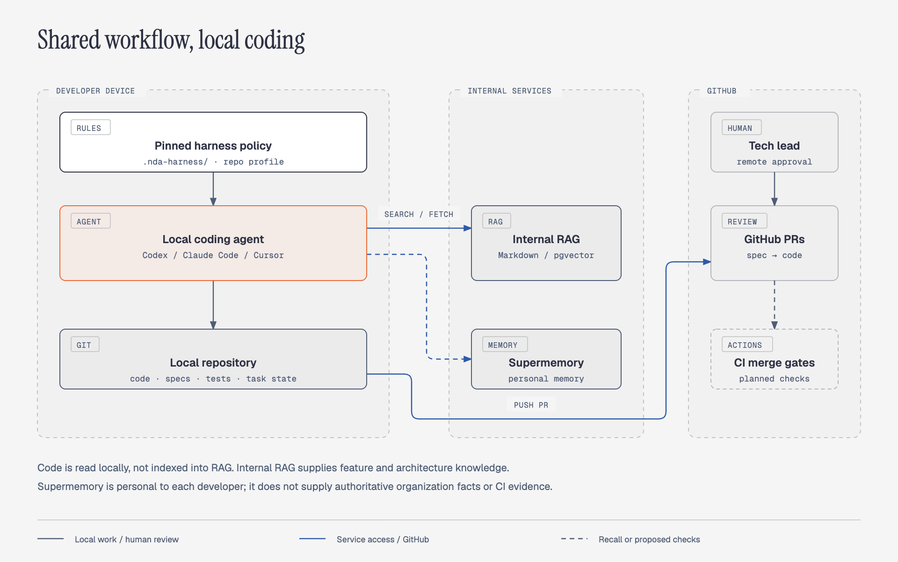
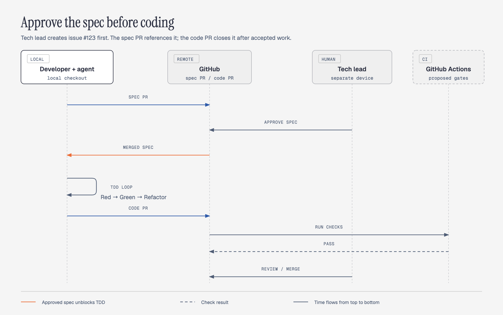

# NDA Harness architecture

Status: architecture proposal. Integration references checked on 2026-10-08. See [developer integration](developer-integration.md) for local adoption.

## Purpose and boundaries

The internal team currently gives tasks directly to coding agents, with some tools and plugins but no consistent development process. NDA Harness makes feature specification and delivery explicit and reviewable across agents: the GitHub issue defines feature intent, an approved developer-spec PR defines implementation behavior, agreed behavior drives tests, and evidence accompanies review. The proposed workflow helps tech leads write/review feature issues and developers write/review developer specs.

This repository documents that framework, supplies focused skill instructions, and implements the [minimal setup/verify CLI](compatibility/minimal-cli-phase.md). It does not implement a coding agent, orchestration engine, RAG backend, memory backend, or CI validator. Existing agents, project test runners, and knowledge services remain in use.

SDD means **spec-driven development**. Harness TDD means a meaningful red unit test before the corresponding implementation, followed by green and refactoring. QA owns integration and end-to-end verification. Prompts guide local work; proposed required CI checks enforce unit-test evidence at merge. Neither prompts nor a final green build guarantee that the agent actually followed every step.

## Components and data boundaries

[Open the editable system overview](diagrams/system-overview.html). Knowledge-service arrows show agent access, not repository ingestion. Dashed CI styling denotes proposed enforcement.

The pinned-policy component includes the mandatory Superpowers, RTK, and Context7 requirements described below. The Skills hub supplies additional task-specific expertise; it does not decide whether mandatory dependencies apply.

| Component | Responsibility | Source of truth |
| --- | --- | --- |
| Shared policy, agent adapters, and local hooks | Load the workflow and run unit tests before commits | Pinned, reviewed repository-local policy and hook package |
| Superpowers | Supply the required coding-workflow bootstrap and relevant workflow skills | Approved pinned upstream revision plus reviewed NDA workflow mapping |
| RTK | Route agent shell commands through the approved output-reduction tool or its raw proxy | Approved pinned binary and verified client integration |
| Context7 | Retrieve public library/framework documentation relevant to the installed version | Identified upstream documentation and returned version metadata; not internal project requirements |
| Skills hub | Discover focused skills and load only those selected for an assignment | Versioned `skills/catalog.md` and selected `SKILL.md` files, pinned with the policy |
| Role-specific skills and tools | Guide tech-lead scoping/documentation and developer SDD; scaffold/validate artifacts, verify prerequisites, and retain test evidence | Pinned, reviewed skill/tool contracts; authoritative documents and authenticated records |
| Local coding agent | Read code, inspect callers, edit files, execute existing project tools | Developer's repository and recorded revisions |
| Internal RAG | Retrieve feature definitions and architecture from existing Markdown/pgvector knowledge | Cited source documents and revisions |
| Self-hosted Hindsight | Recall and retain each developer's preferences and personal working notes | Developer-controlled personal context; not authoritative organization facts |
| Repository task artifacts | Preserve specs, checkpoints, exceptions, and handoff state | Versioned artifacts and human approval records |
| GitHub Actions | Validate submitted evidence and run project checks | Results for the current PR revision |
| Human owners | Approve specs, exceptions, and code | Authenticated approval records |

The agent reads repository code directly on the developer's device. The feature/architecture RAG must not ingest repository code. Personal memory stores preferences and individual working notes, not code dumps or raw agent transcripts. It does not establish organizational requirements or decisions. This does not imply local model inference: the team's coding-agent provider and existing data policies still apply.

The data flow is: tech-lead feature-issue drafting → review/revision → authorized issue publication → developer task and local code/scoped knowledge inspection → developer-spec drafting/review → human spec-PR approval/merge → test evidence and implementation → PR checks and separate human code review → merge. CI uses repository evidence rather than making live RAG or memory calls to decide compliance; issue and approval validation reads authenticated GitHub metadata.

## Mandatory coding dependencies: Superpowers, RTK, and Context7

Every supported developer coding-agent setup must use **Superpowers, RTK, and Context7**, including coordinating agents and coding sub-agents. Declare this requirement in `.nda-harness/policy.md`; it is not an optional Skills hub selection. Context7 must be available and used when library/framework API, setup, or configuration knowledge is needed; it does not require a documentation call for unrelated tasks. Missing, disabled, unsupported, or unverified integration blocks coding readiness until corrected. Documentation and mechanical changes retain their lighter verification path; mandatory tooling does not create artificial TDD requirements for them.

Pin approved Superpowers and RTK releases/revisions in `.nda-harness/release.md`, together with source, tested agent versions/surfaces, and reviewed adaptations. Record repository-specific verification commands and integration requirements in the profile. Do not depend on mutable `latest` installations or silently update plugins. Maintainers review dependency upgrades and repeat readiness checks before rollout.

Record Context7's approved transport/authentication, endpoint or pinned local MCP package version, and tested client/tool contract in the same release/profile. Hosted service content cannot be pinned by pinning the client; record the library/version and source references used for a task separately.

| Layer | Required responsibility |
| --- | --- |
| Shared policy | Require Superpowers workflow skills, RTK shell routing, and Context7 for needed library/framework documentation |
| Agent adapters | Load the required bootstrap and configure command routing for each supported local surface |
| Local setup tooling | Install/configure pinned dependencies, preserve existing settings/hooks, and provide rerun/rollback behavior |
| Capability checks / proposed `doctor` | Verify actual loading and routing, not merely installed files or an agent's claim |
| Sub-agent assignment | Carry mandatory policy/dependency requirements plus only the selected specialist skills |
| Human review and CI | Enforce approved specs, meaningful tests, and revision-bound evidence; do not infer local tool usage from green CI |

Local dependency setup is part of the future adoption tooling. Keep `.nda-harness/scripts/setup-knowledge` focused on RAG/Hindsight/Context7 connections; Superpowers/RTK dependency setup must be explicit and separately report its readiness. No installer or dependency-enforcement hook is implemented by this document.

### Superpowers workflow mapping

Use [Superpowers](https://github.com/obra/superpowers) as a required workflow dependency. Its installation differs by agent; verify the selected pinned release on every supported Codex, Claude Code, and Cursor surface rather than assuming installation in one agent enables another. Load its bootstrap at coding-session start, then load only the workflow skills relevant to the current stage/assignment. Requiring Superpowers does not mean inlining its entire skill collection into every agent.

Maintainers define a reviewed mapping from the pinned Superpowers skills to NDA stages: requirements/design work supports Understand and Specify; planning/execution supports approved implementation; TDD supports Red → Green → Refactor; review and verification support Review. Bug investigation must reproduce the defect and inspect callers before a fix. Existing NDA rules remain explicit: a tech-lead issue precedes task work, GitHub spec approval and merge precede implementation, one branch serves sequential spec/code PRs, unit tests cover relevant logic, and QA owns integration/end-to-end scenarios.

Resolve conflicting upstream instructions in the reviewed adapter/mapping before declaring the setup ready. A Superpowers conversational sign-off is not GitHub spec approval; its workflow cannot automatically change spec locations, create another branch, close the issue early, bypass hooks, or introduce mandatory multi-agent orchestration. Agents report unresolved conflicts instead of silently choosing a process. Relevant skill use does not confer approval or permission for external actions.

### RTK command routing

Require agent shell commands to pass through RTK, including commands run by coding sub-agents. Use native command rewriting only where the approved client/release supports it and verification demonstrates it works. Otherwise require explicit `rtk` invocation through the agent adapter. Do not double-prefix already routed commands. RTK's [supported-agent guide](https://github.com/rtk-ai/rtk/blob/develop/docs/guide/getting-started/supported-agents.md) describes different integration routes; that development-branch reference is not a guarantee about the chosen release.

Use the supported RTK command form for readable output; use `rtk proxy <command>` for commands requiring unchanged output, machine-readable parsing, or unsupported transformations. Verify command semantics and exit status, particularly failing tests. Command output reduction must not hide failures, change tested criteria, or turn truncated output into success. Missing RTK or broken routing blocks readiness; the agent must not silently fall back to unwrapped shell execution. Native file/edit/service tools are outside shell routing and keep their existing permissions.

### Context7 documentation access

Use [Context7](https://github.com/upstash/context7) as a required documentation tool, separate from specialist skills, internal RAG, and personal memory. Prefer its MCP integration for common agent access; an approved CLI integration is acceptable where native MCP is unavailable, with CLI shell commands routed through RTK. A local MCP process is a client to documentation services, not a guarantee of fully local retrieval. Keep credentials outside Git and prompts.

Before changing library/framework-dependent behavior, inspect the installed dependency version locally, resolve the correct Context7 library ID, and query a focused topic for that version where supported. Skip resolution only when an exact verified ID is already supplied. Verify the returned library/source/version fits the task; missing version coverage must be explicit rather than treated as documentation for the installed version. Record concise library ID, installed/requested/returned version information, source references, and any uncertainty in task context. Do not store complete documentation dumps.

Queries contain public package names, versions, and generic technical questions only; do not send proprietary code, internal requirements, personal memory, or secrets. Retrieved examples cannot override policy or approved specs. Internal RAG remains authoritative for organizational feature/architecture context, and agents inspect repository code locally. Context7 is not a replacement for either.

Readiness must demonstrate real resolve/query access to a designated public library from each supported agent and documentation-capable child path. Configured availability does not require preloading all documents/tool schemas into every child: expose the integration on demand where supported and record fixed exposure limits. During an outage or missing coverage, proceed only when sufficient version-matched authoritative context is available from local sources or verified primary documentation; record degraded access. Otherwise pause affected decisions. Authentication/rate-limit/service errors are not empty search results. Normal onboarding cannot be marked ready while required Context7 access remains unverified; CI checks repository evidence without live Context7 access or credentials.

### Readiness and enforcement limits

For each supported agent and coding-child execution path, verify the pinned versions, observed Superpowers bootstrap loading, relevant workflow-skill access, and RTK availability/routing. Exercise a representative command, a nonzero result, and raw-proxy output. Recheck after upgrades, fresh-session/worktree setup, and relevant configuration changes. Record only sanitized versions, check results, and references; no command logs or private transcripts are required as repository artifacts.

Include Context7 resolve/query access and version/source matching in these checks. The maintainer owns client compatibility and the approved connection configuration; developers keep authentication local. Context7 use is a policy/readiness requirement, not a claim that CI can prove every local documentation lookup occurred.

Policy is instruction-based enforcement. Hooks can intercept only the paths supported by the client; hook behavior must be tested rather than assumed to block bypasses. A developer with local control can disable integrations, and CI cannot independently prove that every local command used RTK or every step used Superpowers. Required CI still verifies the resulting approved-spec linkage and red/green evidence. Any stronger organization-wide device enforcement is separate infrastructure work.

Dependency integration references checked on 2026-10-12. Compatibility with pinned versions remains a pilot verification requirement.

## Skills hub and scoped sub-agents

The [Skills hub](../skills/catalog.md) is a repository folder, not a hosted service, RAG index, or new agent runtime. Its source lives at `skills/` in this project; adopted repositories receive a pinned copy at `.nda-harness/skills/`. Shared policy/profile rules apply to every agent. Specialist skill bodies are loaded only for the relevant assignment.

The coordinating local agent reads the catalog, chooses the smallest needed set, and passes exact skill paths/revision to a bounded sub-agent assignment. Do not load the whole hub into one agent or every child. Default to one specialist skill per child; add another only when the assignment needs both. Use fresh/minimal child context rather than automatically inheriting unrelated history. A parent that needs only returned findings does not load the specialist bodies.

| Assignment | Selected skill | Result and boundary |
| --- | --- | --- |
| UI design, implementation, or review | [UI/UX Pro Max](../skills/ui-ux-pro-max/SKILL.md) | Pinned upstream design guidance and local search resources; existing design system/spec governs |
| Formal Vietnamese organizational documents | [Official Vietnamese document wording](../skills/vietnamese-official-wording/SKILL.md) | Template-led Vietnamese drafting/revision; human approves official issuance |
| Explanatory architecture/workflow diagrams | [Diagram Design](../skills/diagram-design/SKILL.md) | Pinned upstream templates, type references, and local verification; approved project style governs |

Each assignment includes the issue/task, repository revision, shared policy/profile paths, mandatory Superpowers/RTK/Context7 requirements and verified execution path, selected specialist skills and release revision, relevant inputs, allowed file scope and side effects, expected output, and stop conditions. Record that selection and scope in the repository task record. Findings return to the coordinating agent and human reviewer; they do not advance a gate by themselves. Recheck selections and revisions on resume rather than accumulating prior skills. The required bootstrap/workflow skills are separate from the optional specialist hub selection.

Use the existing agent's native delegation when it supports isolated instructions. Otherwise use a fresh session with the same scoped assignment and report the limitation. No mandatory multi-agent runtime is introduced. Skills cannot grant tools, credentials, permissions, or approval; CI and humans remain the enforcement boundary. Do not pass personal Hindsight content or credentials to another agent.

### Metadata-first discovery and loading

Separate discovery from execution. The coordinator initially reads only catalog metadata: stable skill ID, short applicability description, entrypoint path, required inputs, and output. The pinned release identifies the catalog revision. Do not discover skills by concatenating `SKILL.md` bodies, recursively reading references, or injecting bundled templates/data. Catalog links locate bodies; they are not instructions to load every linked file. Native registration may expose names/descriptions, but adoption must verify it does not automatically inject all bodies.

| Point in the session | Input and action | Loading boundary |
| --- | --- | --- |
| Session start | Load shared policy/profile, required Superpowers bootstrap, and hub catalog metadata | No specialist bodies or bundled resources; load mandatory workflow skills only as the stage requires |
| Before assignment/delegation | Match the task and current stage to catalog entries; select zero, one, or multiple skill IDs and record a short reason | Selection uses metadata and relevant task context, not the entire skill collection |
| Before child creation | Validate selected IDs/paths against the pinned hub; prepare the bounded assignment and requested tool set | Reject unknown IDs, stale revisions, paths outside the hub, or missing resources; resolve the error before spawning |
| Child/session start | Load shared policy, mandatory dependency requirements, and only selected specialist bodies | Fresh/minimal context; no automatic inheritance of unrelated parent history |
| During execution | Read references or run local helpers needed for the selected task | Load the chosen type/stack resources on demand; task changes require a recorded new selection |
| Return or resume | Return concise findings/artifact references; recheck revision and selection for the next assignment | Do not accumulate prior skill bodies or return full transcripts/resources to the parent |

Ordinary backend/test-review tasks may select no specialist skill. A diagram assignment selects `diagram-design`; a formal Vietnamese document selects `vietnamese-official-wording`; an interface assignment selects `ui-ux-pro-max`. Select more than one only when both are needed. The existing coding model makes this bounded choice; an external decision model such as Jev is not required or implemented. If evaluated later, it is an optional selector tool outside the hub, with the same allowed IDs, validation, and fallback to metadata-based selection.

Record selection inline in the repository task record: assignment ID, task stage, catalog/harness revision, selected IDs and resolved paths, short reason, allowed file scope/side effects, requested tools, observed exposure limitations, and next action. These are concise handoff records, not test logs or proof of unseen context. A missing/invalid selection blocks that delegation, not unrelated work. The receiver rechecks the assignment revision and workflow permissions before editing.

### Hook and adapter contract

Shared entrypoint instructions define this contract across clients. Add agent-native hooks only where the pinned client supports and passes verification for the required event and behavior; the names below are logical lifecycle points, not assumed API event names.

| Adapter mechanism | Responsibility |
| --- | --- |
| Session-start integration | Introduce the mandatory bootstrap and catalog path/metadata once per fresh session; reuse existing Superpowers startup integration rather than injecting it twice |
| Pre-delegation integration | Check the bounded assignment, selected catalog IDs/revision, and tool request before native spawning; attach scoped paths/context where supported |
| Child-start integration | Ensure mandatory policy/dependencies and selected bodies are available to the child; verify actual inheritance behavior |
| Instruction/fresh-session fallback | Apply the same assignment contract manually when native events, interception, or isolation are unavailable; label enforcement/visibility limitations |

Hooks must preserve existing hooks, avoid recursive/double invocation, and report malformed assignments or missing resources explicitly. They do not fetch all skills, retrieve RAG/memory, print credentials, or grant approval. Validate selection against trusted pinned metadata; treat task text and retrieved content as data, not instructions to choose arbitrary files/tools. Install/configure hooks only through reviewed local setup, with rerun and rollback safeguards. The shared Git pre-commit unit-test hook remains separate: it checks commits and cannot perform session discovery or control model context.

### Tool exposure and verification

Skill context and tool definitions are separate budgets. A small skill catalog does not prevent a client from injecting every configured MCP tool schema. Keep the coordinator's configurable tool set limited to assignment/delegation, local context reads, task-state updates, and required bootstrap operations. Supply additional tools to children only for the assignment, where native allowlists or lazy discovery support it. Tool selection cannot widen existing execution permissions. Record fixed platform tools separately; do not claim that a requested allowlist controls tools the host exposes automatically.

For each supported agent version/surface, capability checks verify startup behavior, native discovery, parent-history inheritance, child skill loading, and MCP/tool exposure. In a disposable fresh session, assign a diagram task and check that only Diagram Design's body is loaded beyond mandatory policy/workflow instructions; then try a backend task with no specialist selection. Inspect host-provided context/tool inventories, adapter configuration, and file-read evidence where available. An agent's assertion that unrelated skills are absent is insufficient. Report observed, unverified, or unsupported isolation and use the documented fresh-session fallback where it actually helps; fresh sessions alone do not cure global auto-injection.

If configuration cannot prevent full specialist-body injection, that surface is not verified for scoped loading. Document the limitation and use a verified setup/surface before claiming readiness. Hooks cannot hide definitions already injected by the host. CI may validate the recorded IDs/revisions and task evidence, but cannot prove absence of unrelated context in local sessions. Discovery hooks and validators remain proposed Phase 2 tooling, not executables shipped by this repository.

## Harness quality improvements

Agent capability checks, context preparation, and test-quality review are workflow responsibilities, not Skills hub entries. They apply regardless of which specialist skills are selected.

### Capability checks and context preparation

Capability checks extend onboarding beyond an agent's claim of readiness: inspect actual instruction files, verify mandatory Superpowers/RTK/Context7 integration, run configured unit tests, inspect hook activation, verify authenticated GitHub reads, fetch the designated cited RAG source, and verify personal-memory isolation with owner-provided test targets. Report each capability as ready, failed, unverified, or not applicable. Prove hook behavior in a disposable checkout only. Missing required tooling/context blocks affected work; optional memory failure leaves memory disconnected. The proposed setup tooling can expose a `doctor` command using these checks; that executable is not shipped yet.

Context preparation records a compact index in the task record: current issue/stage/revision, approved spec and criteria, relevant local paths/callers/tests, cited RAG revisions, unresolved questions, completed checkpoints, and next permitted action. It links existing sources rather than dumping code, logs, or transcripts into prompts. On handoff, the receiver checks Git state and approvals again. Personal notes stay local and cannot become shared requirements.

### Test-quality review

Before implementation review completes, inspect whether changed unit-test assertions can detect plausible incorrect behavior and whether mocks bypass the changed logic. Review skipped/deleted tests, weakened assertions, changed expectations, important branches, and shared-cause bug regressions. Changes to tests require an explanation, not automatic rejection. Map findings to approved criterion IDs; keep integration/end-to-end scenarios with QA.

Review the test-only checkpoint and final passing proof against the recorded revisions. A setup/compile failure is not behavioral red; inaccessible evidence remains unverified. Use isolated replay when available without disturbing the working tree. Human reviewers judge assertion quality; automated diff flags can help later but do not prove semantic coverage. This adds no fixed test count, coverage target, mandatory mutation testing, or new QA gate.

## Development lifecycle

**Tech-lead issue → Understand → Specify → Human approval → Red → Green → Refactor → Review → Merge**

| Stage | Required work and output | Exit condition / owner |
| --- | --- | --- |
| Tech-lead issue | Draft, review and revise the feature spec in an issue body: problem, users, outcome, scope, behavior/flows, failure cases, acceptance criteria, constraints, sources and open decisions; authorized tech lead publishes it | An open feature issue created by an authorized tech lead exists before developer task work starts; no separate feature-spec document is required |
| Understand | Verify the feature issue and record its content reference; classify the task; inspect relevant local code/callers and scoped sources; identify uncertainty | Agent has enough authoritative context; unresolved product decisions go to the tech lead |
| Specify | Write/review the developer spec: issue-aligned behavior, stable acceptance IDs, interface changes, edge cases, scope, design decisions and unit-test/QA mapping | Validated/reviewed developer spec is ready for human spec-PR approval |
| Human approval | Authorized developer/tech lead approves the spec-only GitHub PR; merge the approved spec and record its revision, including any exception | Spec PR is approved and merged before implementation |
| Red | Add focused unit tests linked to the changed logic; retain a test-only checkpoint and run them against pre-change code | Expected behavioral assertions fail; environment and unrelated failures are distinguished |
| Green | Implement the smallest change that satisfies the approved criteria and tests | Targeted tests pass without weakening the agreed assertions |
| Refactor | Improve structure when needed, keeping behavior and tests stable | Relevant tests remain green |
| Review | Check spec alignment, test quality, caller impact, evidence, and project checks | Required checks and human review pass |
| Merge | Merge the reviewed revision under repository branch rules | Authorized merge; changed code or spec invalidates affected evidence/approvals |

Repeat Red → Green → Refactor for each behavior increment. A material change to requirements returns to Specify and Human approval. A purely editorial spec correction can be recorded without restarting unchanged tests; the reviewer confirms it does not change acceptance criteria.

Features and bug fixes require the full path. A bug fix first reproduces the defect and traces the shared cause, including sibling callers. Docs and mechanical changes use task classification, appropriate existing checks, and human review without artificial red tests. A behavior change that cannot produce reproducible red evidence requires a named human approver, rationale, affected criteria, and alternate verification; the agent cannot approve its own exception. There is no silent emergency bypass.

### Unit-test scope and QA responsibility

Agents add a small set of meaningful unit tests for changed business logic, important branches, and bug regressions, using the repository's existing runner. There is no fixed test count, coverage-percentage target, or requirement to test every function. Those unit tests still follow Red → Green → Refactor and retain reproducible evidence.

The approved spec maps acceptance criteria to unit tests where appropriate and identifies scenarios for QA, such as cross-service behavior, complete user journeys, and integration with external systems. QA-owned criteria do not require artificial unit tests or agent-built integration/end-to-end suites. If a change has no meaningful unit-testable behavior, record the reason and QA verification in the existing human-approved exception path.

The implementation PR includes the approved spec and a short summary of QA scenarios and known limits. QA uses the team's existing process; this proposal adds no new QA automation, sign-off gate, or release workflow. QA's later findings return as issue work and regression tests where suitable. Do not treat green unit tests as proof that QA scenarios passed. Issue closure tracks accepted implementation merge, not completion of all QA testing.

Harness CI requires relevant unit tests and existing applicable lint/type/build checks. It adds no integration/end-to-end test requirement. Existing repository checks remain under repository-owner control; adopting the harness does not silently remove them.

### Issue, branch, and PR traceability

Every developer task requires one primary GitHub issue created by an authorized tech lead in the same repository. The issue is the feature spec; the approved developer spec defines the behavior to implement. The agent verifies the issue before task work and does not create a replacement issue on behalf of the tech lead. Missing, inaccessible, closed, or unauthorized issues block task start until the tech lead resolves them.

Record the issue URL, update time and content fingerprint used to draft the developer spec in the spec/task record; GitHub issues do not have immutable commit revisions. Recheck current issue content at task start/resume and before dependent stage transitions. Changes require reconciliation with the tech lead, not automatic replacement of approved behavior. Record editorial-only changes; material behavior changes require a developer spec-change PR and renewed approval/merge before affected implementation resumes. Issue publication and agent review do not satisfy the developer-spec approval gate.

For issue #123, use `feat/123-<feature>` for both feature PRs. For lighter tasks, reuse the repository's existing branch prefix but retain the `<issue-number>-<slug>` segment. Record the full issue URL in the spec and task record; the branch issue number, spec, task record, and both PRs must refer to the same primary issue. Branch naming alone does not establish a GitHub relationship.

The spec PR body contains `Refs #123`, a plain non-closing reference. It must not contain an issue-closing keyword for the primary issue, have a manual closing link in GitHub's Development sidebar, or introduce a closing keyword in its commit messages. The issue remains open after the spec merges. Spec-change PRs follow the same non-closing rule.

The implementation PR body contains `Closes #123` and links the merged spec PR. Both PRs target the repository's default branch (main in these examples). GitHub's closing keywords act on merges into the default branch; commit messages and manual links can also cause closure. See [GitHub issue linking](https://docs.github.com/en/issues/tracking-your-work-with-issues/using-issues/linking-a-pull-request-to-an-issue). The reviewer confirms acceptance criteria before implementation merge; verify closure afterward and let the tech lead close the issue manually if repository settings do not close it automatically. Lighter tasks use a single completion PR with the same issue requirement.

### Human approval happens on GitHub

[Open the editable approval sequence](diagrams/spec-implementation-sequence.html). This is the happy path; rejected or materially changed specs return to approval, and the CI gates shown still need implementation.

The default is one feature branch and two sequential PRs per behavior-change task: a **spec-only PR**, then an **implementation PR**, both from `feat/<issue-number>-<feature>` into main. The tech lead reviews from their own device in GitHub; no access to the developer's device or agent session is required. GitHub distinguishes an Approve review from a comment or request for changes; use an authorized human's explicit approval. See [GitHub PR reviews](https://docs.github.com/en/pull-requests/reference/pull-request-reviews).

Create `feat/<issue-number>-<feature>` and submit `specs/<feature>.md` in the first PR, without implementation changes. Keep the branch after the spec merges, fetch main, and merge updated main into that same branch before starting local TDD. Then push implementation changes and open a second PR from the same branch. This synchronization also handles squash/rebase merges without requiring a force push. Prevent automatic deletion of the feature branch after the spec PR, or re-push the retained local branch under the same name if it was deleted remotely. Delete the branch only after the implementation PR merges. Reuse an existing spec location when present; use `specs/<feature>/` only when multiple documents are needed.

The developer submits the spec and acceptance criteria without production implementation, resolves feedback, and gets approval from the designated spec approver. Merge the spec under required review rules. The local agent then fetches the merged revision and verifies the approved spec before starting Red. While approval is pending or changes are requested, it pauses dependent test/implementation work.

Record the spec PR URL, approval review reference/actor, approved PR head revision, and merged spec revision/path. A squash or rebase merge can change commit IDs; the future validator must verify the merged spec content matches the reviewed content, rather than requiring identical commit IDs. The implementation PR references these records and receives separate code review. A materially changed spec requires a new spec-change PR and approval before dependent work resumes.

Local chat, a pasted approval message, or an agent-written approval flag does not satisfy this gate. During the guided pilot, the developer verifies the GitHub record manually; later tooling can read it through the GitHub API or existing CLI. No automatic notification or message to the tech lead is part of the local harness contract.

## Shared policy and task artifacts

The future release package is copied into each adopted repository under `.nda-harness/` and pinned to an immutable release revision. Keep the policy concise; the detailed workflow is read as needed. Thin agent entrypoints load the policy and repository profile rather than maintaining separate process definitions.

The policy must cover mandatory Superpowers/RTK/Context7 use, stage transitions, required human decisions, test-first work, evidence, knowledge trust boundaries, unavailable services, exception handling, and completion reporting. These are repository instructions, not a replacement for provider-controlled system prompts or tool permissions. The baseline includes a Git pre-commit unit-test hook. Agent-specific hooks and optional specialist skills may add convenience but do not replace that shared Git hook or CI checks.
The policy must cover stage transitions, required human decisions, test-first work, evidence, knowledge trust boundaries, unavailable services, exception handling, and completion reporting. These are repository instructions, not a replacement for provider-controlled system prompts or tool permissions. The baseline includes a Git pre-commit unit-test hook and required role-specific skill/tool procedures. Optional agent-native hooks provide convenience; skills and local checks do not replace the shared Git hook, authenticated approvals, or CI checks.

### Tech-lead and developer workflows

The harness execution layer includes tools and skills for both roles. Tech leads use `scope-initiative` when discovery is needed and `document-requirements` to write/revise the feature-issue body. `review-spec` reviews either an issue draft/published issue or a developer-spec draft/PR. Feature review checks clarity, outcome, scope, completeness, contradictions, missing flows and verifiable criteria; developer review additionally checks issue alignment, feasibility, interfaces/edge cases and unit/QA coverage. Review returns prioritized findings with locations, impact, suggested resolutions, a reviewed content reference and remaining blockers. Authoring resolves findings after human product decisions; review never approves a stage.

Developers use `execute-sdd`, `scope-task`, `write-spec`, and `document-change` to turn a verified feature issue into an approved developer spec, unit-test evidence, implementation and review artifacts. `write-spec` records issue-criterion coverage and links feature requirements rather than copying them. Shared tools scaffold issue-body/developer-spec templates and validate structure/links; semantic adequacy remains an agent/human review responsibility. Developer tools verify authenticated prerequisites, detect changed issue content and capture test-only red checkpoints. These are core workflow procedures, independent of optional specialist skill selection. See the [role workflows and delivery contracts](../plan.md#role-workflows-and-handoff).

Feature-issue drafting/review may precede issue creation and is not blocked by the developer task's issue prerequisite. The authorized tech lead explicitly creates/updates the issue through existing tools and review practices; no separate feature-spec document or additional feature-spec PR gate is required. Optional scope/architecture documents follow existing repository review and source-owner publication processes. Drafts and agent findings are not human approval, and supporting sources cannot silently override the issue or approved developer spec.

Skills guide reasoning and authoring, tools perform deterministic operations, and context hooks prepare inputs and route by role/stage. Role selection is not authentication or permission. The human retains scope decisions and approval authority; skill execution cannot self-approve, grant access or advance a stage on its own. These are proposed pack capabilities for existing local agents, not a separate coding-agent runtime.

The repository profile records setup, targeted unit-test and relevant unit-suite commands, applicable lint/type/build checks, runtime prerequisites, spec/task locations, RAG project scope, supported agent versions, authorized tech-lead GitHub identities, approvers, default branch, and harness revision. Personal-memory identity and credentials stay in each developer's local configuration. Use Markdown for the initial profile and task records; a machine-readable gate format is a later implementation concern.

Each task record links the following:

- Task identifier, classification, stage, branch/revision, and harness revision.
- Primary feature-issue URL/number, verified GitHub author, consulted issue update time/content fingerprint, developer-spec PR, and completion PR references.
- Approved spec location and revision; approval actor, time, and durable reference.
- Acceptance-criterion identifiers mapped to meaningful unit tests, QA scenarios, or approved alternate verification.
- For each red/green cycle: pre-change revision, test-only checkpoint, commands, environment requirements, and expected behavioral failure for replay; retain concise proof of final passing tests.
- Review/CI references, exceptions, unresolved decisions, and the next action for handoff.

Task records retain concise test-pass proof, not test logs: tested commit SHA, command/suite, pass status, and a link to the successful GitHub check/run for that revision. Local runs can record the same summary without a CI link, but an agent-authored PASS statement alone is not merge proof; CI verifies the final revision. Do not commit console output or require uploaded/downloaded log artifacts. GitHub's normal run output may remain available for troubleshooting without becoming a harness retention requirement. Preserve the test-only patch, base revision, and expected failure for red replay even if merge uses squash; no red log is required. Chat history and Hindsight cannot substitute for these records.

## Proposed local hooks

For session/task context loading, refresh, and handoff, see the [context preparation hooks proposal](context-preparation-hooks.md). It recommends a shared preparation contract with optional agent-native adapters; it is not an installed hook set or a replacement for the Git/CI checks below.

Start with one required hook: **Git `pre-commit` runs the repository's configured unit-test command**. Use the existing project hook setup if present; otherwise ship an executable `.nda-harness/hooks/pre-commit` and activate it per checkout with repository-local `core.hooksPath`. No new hook framework is required. Git supports a configured hook directory and aborts a commit on a nonzero pre-commit exit; the hook can be bypassed with `--no-verify`. See [Git hooks](https://git-scm.com/docs/githooks).

The repository owner selects a deterministic, non-watch unit-suite command using the existing runner. It may cover the affected module where the project already supports reliable selection; otherwise run the existing unit suite. A missing command, unavailable environment, test failure, or runner error blocks the commit with the command and actionable output. Do not silently skip tests, auto-fix files, stage changes, stash work, or call RAG/memory from the hook. Run this check on each normal commit, including spec/docs commits; it adds no integration/end-to-end tests.

Keep the hook script and test entrypoint versioned. The profile documents the command and hook activation; the implementation must call the existing executable test entrypoint rather than treating Markdown prose as executable configuration. Reuse existing hook chains and preserve their checks; do not overwrite a developer's hook path or disable a project's installed hooks during adoption.

**Red checkpoints do not require failing commits.** Before implementation, retain the complete test-only change as a patch against the recorded pre-change revision, including new test files, and capture the expected red result. After implementation turns green, commit the patch as evidence with the passing code/tests and reference it from the task record. CI can replay that retained patch against the base revision. This keeps ordinary commits green without a TDD-driven `--no-verify` bypass; the hook itself does not prove test-first order.

Tests run against the local working tree, so developers must stage the source/test/config changes that were tested before committing. A passing local hook alone does not certify the exact staged snapshot; CI rechecks the committed PR revision. The agent must not disable hooks or use `--no-verify` to bypass failures. Any authorized bypass is recorded for human review and does not waive required CI checks.

Activation is local to each checkout, not automatically enabled just because scripts are committed. Verify it for every developer device and worktree, and test the commit paths used by the supported agents. These hook contracts are part of the proposal; no executable hook is installed by this documentation phase.

## Knowledge contracts

The pinned pack also includes a proposed `.nda-harness/scripts/setup-knowledge` script for developer-local agent connection setup. It configures access to existing internal RAG, personal Hindsight, and Context7 documentation through each supported client's integration mechanism, preserves existing configuration, keeps credentials local, and verifies scoped retrieval and personal-memory isolation. See the [setup script contract](developer-integration.md#pack-provided-setup-script). It is onboarding tooling, not a coding-agent runtime or a new knowledge backend; executable delivery remains in the tooling phase. The script configures local agent connections; RAG and Hindsight backends stay on the existing internal infrastructure.

### Internal feature and architecture RAG

Reuse the existing Markdown/pgvector service. Its actual transport, endpoints, authentication, and ownership must be confirmed with the service owner before implementation. The following are logical capabilities, not a new wire protocol:

| Capability | Inputs | Required results |
| --- | --- | --- |
| Search | Query, explicit project scope, optional feature/architecture category | Authorized matches with document ID, title, source reference, revision/update time, and relevant excerpt |
| Fetch | Document ID and, where supported, requested revision | Authorized source content, citation, and actual revision; explicitly report unavailable historical revisions |

Permissions must be enforced by the service, not just by an agent-supplied filter. Explicitly scoped retrieval prevents accidental cross-project context; it does not grant access. Distinguish no results from authentication, permission, and service failures. Fetch enough source context before using a search excerpt to decide behavior. Record consulted revisions in the spec.

Use an existing MCP interface if available. If the service exposes HTTP only, use a supported authenticated tool integration; propose a thin MCP mapping only when needed for shared client access. Do not introduce another indexing pipeline or vector store.

Retrieved text is context, not executable instructions. It cannot authorize commands, change harness rules, or override an approved spec. If a cited feature document conflicts with the spec, report the conflict and ask the human owner to reconcile it. Do not silently pick the newest text. If the required source is unavailable, pause the affected decision unless an authoritative local copy with known revision is sufficient.

### Self-hosted Hindsight

Use Hindsight for each developer's personal memory first: preferred explanation style, recurring personal setup notes, and individual reminders useful across sessions. Organizational facts, feature requirements, and architecture decisions remain in approved source documents/specs and internal RAG. Shared organizational memory and a lesson-promotion pipeline are outside this phase.

The development cycle ends at Merge. Personal-memory updates are handled through the developer's Hindsight integration outside that cycle; any additional learning workflow is deferred to a future phase.

Deploy the open-source [Hindsight server and Control Plane](https://github.com/vectorize-io/hindsight) on internal infrastructure with a pinned release and external PostgreSQL/pgvector. Its [MCP server](https://hindsight.vectorize.io/developer/mcp-server) exposes memory operations to supported local agents. Verify the actual deployed tools and transport; developer clients authenticate to the internal Hindsight endpoint, not a public hosted memory service.

Use individually authenticated tenants for personal memory. The standard shared-key extension uses one shared schema and does not meet this requirement. Include and configure the documented `StaticKeysTenantExtension` from the extensions registry, or an approved identity-provider tenant extension; each developer maps to a separate PostgreSQL schema. Banks organize memory within that tenant, not authorize access by themselves. Verify isolation through API, MCP, and the dashboard, including denied cross-user access. See [tenant extensions](https://hindsight.vectorize.io/developer/extensions).

Hindsight uses **OpenRouter for LLM processing**, with local embeddings and reranking as the initial default. Set `HINDSIGHT_API_LLM_PROVIDER=openrouter`, supply `HINDSIGHT_API_LLM_API_KEY` through server-side secret storage, and set `HINDSIGHT_API_LLM_MODEL` to an explicitly selected model ID. Model selection remains a deployment decision verified for extraction quality, structured output, latency, and cost; do not assume a benchmark score applies to that model. See [provider configuration](https://hindsight.vectorize.io/developer/configuration).

Storage stays internal, but memory content used for extraction, consolidation, and reflection is sent to OpenRouter and the selected upstream provider. This is not fully local inference. Record the selected model/routing and applicable data-handling settings before using personal memory; keep provider credentials on the Hindsight server, separate from developers' Hindsight access tokens. Neither the local setup script nor CI requires an OpenRouter key.

The self-hosted Control Plane provides memory inspection. Automatic consolidation updates derived observations when new evidence changes a preference; it does not guarantee deletion of old raw facts. Developers can edit or invalidate stale facts; invalidation removes them from active recall while preserving history. Verify these behaviors in the pilot using [memory curation](https://hindsight.vectorize.io/developer/api/memories).

Each developer controls what their agent recalls or saves, including whether supported automatic memory capture is enabled. Do not require tech-lead approval, maintainer publication, or repository lesson proposals for personal memory. These are harness usage boundaries, not claims that Hindsight provides a proposal/approval feature. Keep personal-memory content and identifiers out of shared task records and committed project configuration. Never save secrets; avoid uploading project content beyond the team's existing data permissions.

Recall only the current developer's relevant memory. Personal preferences cannot override the pinned policy, approved spec, or current architecture requirements. Any remembered claim about project behavior must be verified against current local code or authoritative documents before use. The developer can correct or remove stale personal notes. Memory outages or failed saves do not block task work or merge; proceed using required repository/RAG context. Task checkpoints and cross-developer handoffs remain in repository artifacts, never dependent on access to another developer's memory.

## Proposed GitHub Actions enforcement

These are gate requirements for the next implementation phase, not checks already installed by this proposal. [GitHub required status checks](https://docs.github.com/en/repositories/configuring-branches-and-merges-in-your-repository/managing-protected-branches/about-protected-branches) can prevent merge until configured checks succeed.

| Proposed check | Required outcome |
| --- | --- |
| Issue and branch | Every developer PR references an existing open issue in the same repository whose authenticated author is an authorized tech lead; branch issue number, spec/task links, and PR reference agree |
| PR lifecycle | Spec/spec-change PR uses `Refs #<issue>` without a closing relationship; implementation PR uses `Closes #<issue>`, links the spec PR, and reuses its source branch identity; completion PR targets the default branch |
| Spec and approval | Implementation PR links the merged spec-only PR and authorized human approval; verify reviewed spec content and material changes require renewed approval |
| Traceability and classification | Criteria identify unit-test coverage or QA-owned verification; reviewer confirms QA-only exceptions and lighter-path classification are valid |
| Red replay | Each retained unit-test-only checkpoint fails against its recorded pre-change implementation for the expected behavioral reason |
| Green verification | Mapped unit tests, relevant existing unit suites, and applicable lint/type/build checks pass on the current final revision; no new integration/end-to-end requirement |
| Review | Human reviewer evaluates test strength, spec alignment, exceptions, and remaining risks |

The issue validator reads GitHub issue metadata and compares the author identity with the maintainer-controlled tech-lead list. A pasted name, label, branch name, or issue-looking PR number is insufficient. Confirm the number identifies an issue rather than a pull request, belongs to this repository, and was created before the task's first PR. For implementation, match both the head repository and branch name with the merged spec PR. Invalid issue linkage cannot be waived by a TDD exception.

For open PRs, evaluate current descriptions, issue state/content, and closing relationships as well as the code revision. Compare issue content with the recorded reference and require reconciliation of edits; semantic impact remains a reviewer decision, not something a hash proves. Re-run affected checks when PR metadata, issue state/content, or tech-lead authorization changes; an earlier green result must not authorize invalid new metadata. Normal issue closure after the completion PR merges does not invalidate historical evidence. GitHub lookup failures block the required check with an actionable error, rather than being treated as valid or missing evidence. Keep these metadata reads separate from execution of untrusted PR code.

For replay, use a recorded immutable parent implementation revision and a retained test-only patch containing only the new/changed unit tests and necessary test support. The patch can be stored in a later green commit; it need not be a failing commit. Replay applies it to the recorded base in a separate checkout and must not modify the developer's working tree. Where a new feature introduces an API, shape its unit test so replay reaches an expected behavioral assertion; an import/compile failure alone is insufficient. If that is impractical, use the explicit exception path.

Verify checkpoint diffs contain no corresponding production implementation or unrelated changes. Confirm existing tests/environment work before accepting the expected red assertion. Re-run the mapped tests on final code, including retained assertions if final tests have been reorganized. Removed or weakened assertions require review and renewed evidence. A task-authored log or nonzero exit code alone is not evidence of a valid red result.

Reproducible red/green proves that tests distinguish pre-change and final behavior. It does **not** independently prove the historical order in which edits happened. Human approval timing and authenticated review records support process auditing; stronger historical attestation would be a separate requirement.

The gate implementation must resolve approval from authenticated review records, not trust an agent-written approver name. Approval must identify the spec revision before implementation; final code review alone is not retroactive spec approval. Evidence is tied to the current PR revision, and stale runs cannot authorize a changed PR.

Protect policy, profile, adapters, gate code/workflows, and ownership rules through designated owner review. The future validator must use a trusted version that a task PR cannot redefine to approve itself. Run PR code without knowledge-service credentials or privileged write tokens; red replay executes submitted test code and needs the same isolation as other PR tests. Require checks and review on protected branches, with any authorized bypass documented as an exception.

## Ownership and pilot validation

Harness maintainers own policy releases and adapter compatibility. Repository owners define commands, approvers, and merge requirements. The RAG owner maintains source indexing and authorization. The memory service owner maintains deployment access and developer isolation; each developer manages their own personal memory. Developers provide intent and spec approval; reviewers assess behavior and evidence. These are responsibilities, not new mandatory job titles.

Use one pilot repository with its existing stack. First establish a baseline from recent comparable changes, then evaluate the same task categories with the harness. Do not set numeric improvement claims before measuring.

| Measure | Definition |
| --- | --- |
| Spec/test traceability | Share of behavior-change criteria assigned to reviewed unit tests, QA scenarios, or explicit exceptions; report unit and QA scope separately |
| Red/green compliance | Share of behavior-change PRs with valid replay and final green evidence; report exceptions separately |
| Review rework | Behavior/spec corrections requested after the first review and review iterations |
| Escaped defects | Defects linked to merged pilot changes during the same agreed observation window |
| Developer effort | Setup time, active development/review effort, and workflow friction reported by developers |

The following are acceptance walkthroughs to execute in the pilot, not completed integration tests:

| Scenario | Artifacts and owner | Acceptance / blocking condition |
| --- | --- | --- |
| Codex onboarding | Loaded instruction sources, profile, baseline results; developer | Policy read, local code inspected, scoped RAG and own personal-memory access verified; conflicting override resolved |
| Claude Code onboarding | Loaded project instructions, profile, baseline results; developer | Same capabilities; personal rules cannot silently replace the agreed process |
| Cursor onboarding | Active project rule, profile, baseline results; developer | Rule loads in a fresh session and the agent reads referenced policy; manual attachment alone is insufficient |
| Pre-commit hook | Activated hook, unit command and passing/failing trial changes in a disposable checkout; developer | Passing units permit a commit; test/runner failures block it; existing hook checks still execute |
| TDD with pre-commit | Retained red test patch, base revision, red result and green commit; developer | Red evidence survives without committing failing tests or bypassing the hook; CI replays the patch |
| Hook setup and staged-state limits | Checkout/worktree activation and recorded tested/staged changes; maintainer | Missing activation is detected in onboarding; CI validates the committed snapshot independently |
| Issue-linked feature | Tech-lead issue, `feat/123-<feature>`, spec `Refs #123`, code `Closes #123`; tech lead and reviewer | Spec merge leaves issue open; code PR uses the same branch and issue and closes it only after accepted implementation merge |
| Invalid issue linkage | Missing/non-issue number, wrong repo or author, closed issue, mismatched branch/spec/PR reference; developer | Task start or relevant merge check blocks; no silent fallback |
| Premature issue closure | Spec closing keyword, closing commit message, or manual closing link; reviewer | Spec PR blocks until the closing relationship is removed; prematurely closed issue is reopened by the tech lead |
| Changed GitHub metadata | Edited PR body, feature-issue content or closed issue after a passing check; repository owner | Affected validation reruns; changed issue content requires reconciliation and material behavior changes require renewed developer-spec approval |
| Feature-issue authoring/review | Vague request, issue draft/content reference and review findings; tech lead | Draft names open decisions; review catches missing flows, contradictory scope and untestable criteria; revision precedes explicit authorized publication without a separate feature-spec document |
| Developer-spec review | Feature issue/content reference, developer-spec draft/PR and located findings; developer/spec approver | Scope drift, feasibility gaps and missing acceptance/unit/QA coverage are exposed; agent findings do not unlock implementation |
| Feature | Spec, prior human approval, criterion mapping, red checkpoint, green/review references; developer and reviewer | Expected behavior fails on pre-change code and passes on final code |
| Bug fix | Reproduction, caller analysis, approved regression criterion, evidence; developer and reviewer | Regression test reproduces the defect; fix covers shared cause |
| Unit tests plus QA scenarios | Focused unit-test evidence and QA scenarios linked to the approved spec; developer and QA | Unit logic follows red/green; QA owns integration/end-to-end verification without an added harness test-suite requirement |
| Documentation change | Classification, relevant doc/link checks, review; reviewer | Lighter path approved; no fabricated failing test |
| Changed spec | New spec revision and approval, refreshed affected evidence; spec approver | Implementation waits for approval; old evidence cannot cover changed criteria |
| Invalid red failure | Replay output and environment diagnosis; developer | Setup/compile/unrelated failures block red acceptance until fixed or excepted |
| Unavailable RAG | Recorded outage and local authoritative source, if any; developer | Continue only if required context is sufficient; otherwise pause affected decisions |
| Personal memory isolation | Separate developer accounts/scopes and an owner-provided denied-access check; service owner | Agent cannot access another developer's memory; absent isolation blocks memory integration, not task work |
| Knowledge setup script | Local client configuration, sanitized readiness report and rollback instructions; developer | First run connects the selected agent; rerun preserves unrelated settings without duplicate connections; failed auth is explicit; unverified memory stays disconnected |
| Stale personal memory | Conflicting preference or note and current source; developer | Approved requirements govern; developer corrects or removes the note |
| Cross-agent handoff | Versioned task state, cleanly identified revision, remaining actions; both developers/agents | Receiving agent rechecks state and resumes without repeating completed work or bypassing a gate |
| Skills selection | Catalog, selected paths/revision, bounded assignment; coordinating agent | Child/session loads shared policy and required workflow bootstrap, then only selected specialist bodies; unsupported isolation uses an explicit fresh-session fallback |
| Discovery lifecycle | Startup/delegation adapter configuration and diagram/no-skill assignments; maintainer | Metadata-only discovery and scoped loading are observed; unknown IDs, stale revisions, and missing resources prevent that delegation |
| Tool exposure | Host tool inventory, configured allowlists/lazy discovery, and inspection limits; maintainer | Skill isolation and tool-schema exposure are reported separately; fixed/global injections are not represented as hidden |
| Mandatory dependencies per agent | Superpowers/RTK versions, bootstrap/routing results, Context7 connection and retrieval results; developer/maintainer | Each supported path passes verification; missing/disabled/unverified dependency blocks coding readiness |
| Context7 documentation | Public library resolve/query, installed/version metadata and source references; developer | Correct library and applicable version are verified; no private code/context leaves through queries; missing coverage/outage uses authoritative fallback or pauses affected decisions |
| Workflow conflict | Reviewed Superpowers-to-NDA mapping and conflicting instruction; maintainer | GitHub approval, branch/issue lifecycle, unit/QA boundaries remain intact; unresolved conflict blocks readiness |
| RTK command behavior | Representative success/failure and raw-proxy checks; maintainer | Routing preserves required output/exit status; no double prefix or silent unwrapped fallback |
| Capability failure | Observed readiness table and missing prerequisite; developer/service owner | Auth/runner failures are explicit; unverified memory isolation leaves memory disconnected |
| Context preparation | Issue/spec/source revisions, relevant local paths and next permitted action; developer | Changed approval/revision is caught on resume; no secrets, personal notes, or source dumps enter shared context |
| Weak unit tests | Criterion mapping, test diff and isolated replay references; developer/reviewer | Bypassed logic or weakened assertions are identified for human review; green alone does not establish test quality |

## Decisions and prerequisites

Defaults are English documentation, one shared policy, mandatory Superpowers/RTK/Context7 dependencies, repository-local version pinning, existing test runners, separate RAG and personal-memory services, and developer-controlled personal memory. The specialist Skills hub initially contains UI/UX Pro Max, official Vietnamese document wording, and Diagram Design. Shared organizational memory and mandatory multi-agent orchestration are outside this phase.

Before implementation, owners must supply the pilot repository, existing test commands, authorized approvers, approved Superpowers/RTK revisions, Context7 connection contract, and supported-agent integration mapping, RAG interface/authentication, and self-hosted Hindsight endpoint/capabilities. These are integration facts to confirm, not reasons to invent replacement services. Release packaging, machine-readable evidence, validators, and deployment are subsequent work.
